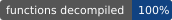
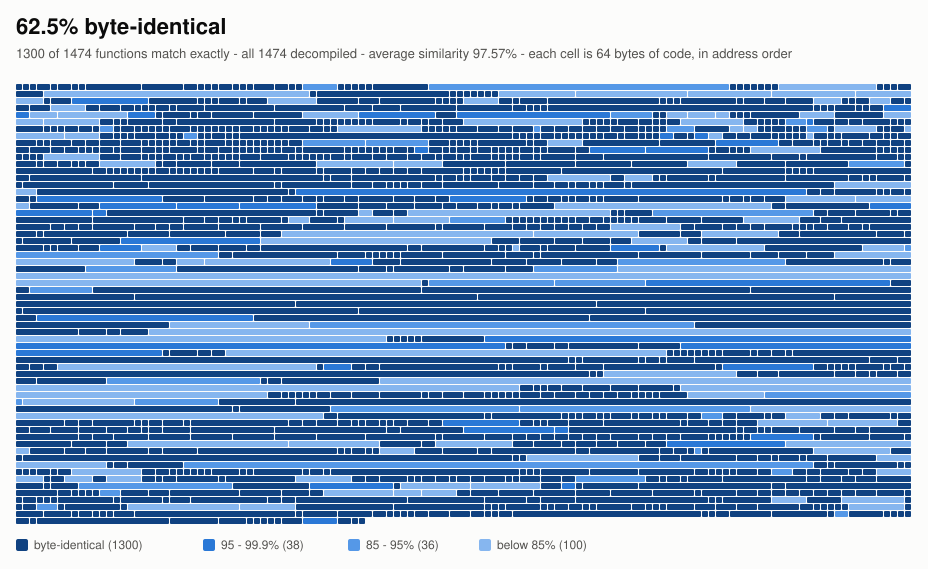

# 2EZDecomp

A **matching decompilation** of a 2000s PC-based arcade rhythm game:
C/C++ source reconstructed so that, built with the original toolchain
(Microsoft Visual C++ 7.1, `cl.exe` 13.10.3077), each function compiles to the
same bytes as the original executable. Progress is checked function by
function with [reccmp](https://github.com/isledecomp/reccmp).

**This repository contains no game content.** There is no executable, no
assets, no music or charts, no key or data tables, and no hexdumps. Building
or verifying anything requires **your own legally obtained copy** of the game.
The project is not affiliated with, endorsed by, or connected to the game's
developers or rights holders. Any product names that appear in the source or
docs refer to the original software and are the property of their owners.

## Target

The matching target is one specific build. Identify yours before building:

| | |
|---|---|
| Game | EZ2AC : FINAL EX |
| Version | **2.05**: shown as "Version 2.05" on the test-mode screens (the build number `205` at `0x4a8d6c`) |
| Build date | 2021-07-30 (PE timestamp) |
| Data version | `GameVersion = 150` in `system/title/Common/version.ini` (written to the log as "Game Version = 150") |
| Executable SHA-256 | `858ca451ca16225ce56d7b902c61f2c7bb813d8c65b85131d85e77fb566af833` (as shipped, `EZ2AC.exe`) |
| Matching image SHA-256 | `e7d85105b417add292efdc3116e7d2cf73301588f2741dddef93bed107a9ded8` (`original/EZ2AC_Unpacked.exe`, the unpacked image reccmp compares against; also in `reccmp-project.yml`) |

The shipped executable is packed. The unpacked image must be produced from
your own copy; this repository does not include one or describe how.

## Progress

<picture>
  <source media="(prefers-color-scheme: dark)" srcset="docs/progress/progress-dark.svg">
  
</picture>

Every function in the game has decompiled C. The map shows how much of it
already compiles to **exactly** the original bytes: each cell is 64 bytes of
the original code, in address order, coloured by its function's match.

| | |
|---|---|
| Functions decompiled | **1474 / 1474** (100%) |
| Functions byte-identical | **1300 / 1474** (88.2%) |
| Code byte-identical | **62.5%** (309,969 of 495,930 bytes) |
| Average similarity (reccmp) | **97.6%** |

The byte share trails the function count because the largest functions
(screen directors, the game loop) are the hardest to match. Figures are
regenerated with `scratchpad/progress.py` (see `CONTRIBUTING.md`).

## Contributing

See [`CONTRIBUTING.md`](CONTRIBUTING.md): how to pick a target, read a diff,
use the codegen cookbook and the source permuter, and check that a change
keeps the behaviour.

## Layout

| Path | What it is |
|---|---|
| `src/`, `include/` | the reconstructed source (one `// FUNCTION:` annotation per original address) |
| `match.sh` | build with the VC7.1 toolchain under Wine and run reccmp |
| `docs/cookbook.md` | every codegen pattern learned while matching, with evidence |
| `scratchpad/` | analysis and verification scripts (see `scratchpad/perm/README.md` for the source permuter) |
| `scratchpad/fmt/` | runs the decomp's own file-format code on the user's game data and diffs it against an independent decoder |
| `reccmp-patches/` | patches to reccmp used by this project (AGPL-3.0, see that folder) |
| `wip/` | analysis notes |
| `docs/progress/` | the progress map, badges and figures (`scratchpad/progress.py`) |
| `CLAUDE.md` | the working rules and conventions of the project |

## Building and matching

You need, none of which is included:

- Microsoft Visual C++ .NET 2003 (`cl.exe` 13.10.3077, `link.exe` 7.10), the
  Windows Server 2003 SP1 Platform SDK and the DirectX 8 SDK, under `tools/`;
- Wine, with a dedicated prefix in `tools/wineprefix` (see `CLAUDE.md` for the
  settings that keep the build headless);
- reccmp (with the patches in `reccmp-patches/`) in `.venv`;
- your own copy of the game's executable in `original/`.

Then `./match.sh` builds everything and prints the match table, and
`./match.sh 0xADDRESS` shows the diff for one function.

## Licence

The reconstructed source, scripts and documentation are released under the
GNU General Public License v3.0 or later (`LICENSE`). The files in
`reccmp-patches/` modify reccmp and are under the GNU Affero General Public
License v3.0 or later, as reccmp is. This licence covers only the
contributors' own work; it grants nothing in the original game.
